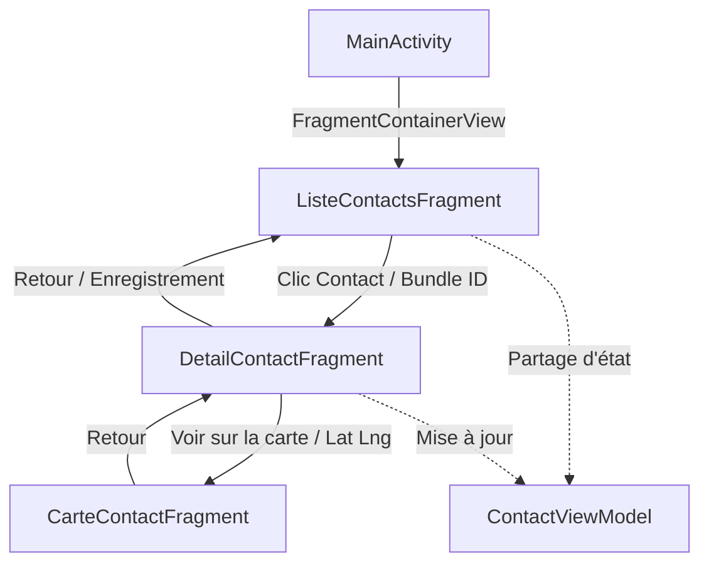

# TP Android — Gestion des contacts (VERSION 3)

**Auteur** : Maram Hsoumi  
**Technologies** : Kotlin • Android Studio • Architecture Single-Activity • Fragments • RecyclerView • Google Maps SDK  

---

## 📌 Présentation et Objectifs
Cette application constitue l'évolution **V3** de la gestion de contacts sous Android :
1. **Architecture Single-Activity** : `MainActivity` héberge dynamiquement les fragments dans un `FragmentContainerView`.
2. **Fragments dynamiques** :
   - `ListeContactsFragment` : Affichage de la liste et barre de filtrage temps réel.
   - `DetailContactFragment` : Fiche détaillée, édition, prise de photo (caméra/galerie) et actions d'appel/email.
   - `CarteContactFragment` : Intégration du SDK Google Maps avec affichage du marqueur géolocalisé.
3. **RecyclerView personnalisée** avec ViewHolder optimisé et gestion sans décalage d'indice après filtrage.
4. **Sécurisation de la clé d'API Google Maps** (non exposée dans le dépôt GitHub).

---

## 🏛️ Architecture de l'application

---

## 🚀 Fonctionnalités implémentées

- **Liste et filtrage** :
  - `RecyclerView` affichant : Photo / Avatar, Nom complet, Téléphone.
  - Champ de recherche au fil de l'eau insensible à la casse (`nom`, `prénom`, `téléphone`).
  - Affichage d'un message explicite si aucun contact ne correspond à la recherche.
- **Détail et édition** :
  - Modification de toutes les informations avec validation des champs requis.
  - Choix de photo depuis la galerie (`ActivityResultContracts.GetContent`) ou prise via caméra (`TakePicturePreview`).
  - Déclenchement d'appels via Intent implicite (`Intent.ACTION_DIAL`).
  - Envoi de mails via Intent implicite (`Intent.ACTION_SENDTO`).
- **Coordonnées GPS & Cartographie** :
  - Support des coordonnées `latitude` ([-90; 90]) et `longitude` ([-180; 180]).
  - Bouton "Voir sur la carte" ouvrant Google Maps centré avec marqueur sur le contact.
  - Alerte explicite si le contact n'a pas de coordonnées enregistrées.

---

## ❓ Réponses aux Questions de Compréhension (Section 11)

### 1. Quelle différence existe-t-il entre une Activity et un Fragment ?
- Une **Activity** représente un point d'entrée système autonome avec sa propre fenêtre (Window). Elle possède un cycle de vie complet géré directement par le système d'exploitation Android.
- Un **Fragment** est une portion réutilisable d'interface utilisateur intégrée et hébergée à l'intérieur d'une Activity. Il possède son propre cycle de vie (fortement lié à celui de son activité hôte) et permet de concevoir des interfaces modulaires et multi-écrans sans avoir à recréer des activités lourdes.

### 2. Pourquoi utiliser `FragmentContainerView` et `addToBackStack()` ?
- **`FragmentContainerView`** : Composant officiel recommandé par AndroidX qui résout les problèmes d'animations et d'incohérences de layout rencontrés avec l'ancienne balise `<fragment>` ou les `FrameLayout`.
- **`addToBackStack()`** : Permet d'enregistrer la transaction de remplacement de fragment dans la pile de retour (Back Stack). Lorsque l'utilisateur clique sur le bouton retour (physique ou système), Android dépile le fragment actuel et réaffiche l'état précédent au lieu de fermer l'application.

### 3. Quel est le rôle de `RecyclerView.Adapter` et de `ViewHolder` ?
- **`RecyclerView.Adapter`** : Fait le pont entre les données métier (la collection de contacts) et l'interface graphique. Il instancie les vues des éléments (`onCreateViewHolder`) et les alimente avec les données (`onBindViewHolder`).
- **`ViewHolder`** : Met en cache les références vers les sous-vues (`findViewById`) de chaque ligne d'élément. Cela évite des appels répétés et coûteux à `findViewById` lors du défilement, garantissant une grande fluidité (60 fps).

### 4. Comment éviter une erreur d'indice après filtrage ?
Lors d'un filtrage, la liste affichée par l'Adapter a une taille et un ordonnancement différents de la liste complète source. Si l'on utilisait la position de la ligne (`position`), on pointerait vers le mauvais contact dans la liste d'origine.  
**Solution** : L'Adapter bind l'objet métier complet `contact` (et son identifiant unique `id`) directement lors du clic (`onContactClick(contact)`), ce qui garantit l'ouverture du bon contact indépendamment du filtre.

### 5. Pourquoi transmettre l'identifiant d'un contact plutôt que la position de sa ligne ?
L'identifiant (`id: Long`) est immuable et désigne de manière unique le contact dans la source de données, même si les éléments sont triés, filtrés, ajoutés ou supprimés. La position de la ligne est volatile et varie selon les tris et filtres.

### 6. Comment garantir qu'une clé Google Maps ne soit pas exposée dans GitHub ?
On exclut le fichier contenant la clé (par exemple `local.properties` ou `secrets.properties`) via le fichier `.gitignore`. Dans `app/build.gradle.kts`, la clé est lue dynamiquement depuis ces fichiers locaux et injectée comme `manifestPlaceholders["MAPS_API_KEY"]`. Ainsi, le code commité sur GitHub ne contient aucune clé secrète.

---

## 🧪 Cahier de tests validés

| Scénario testé | Comportement attendu | Résultat |
| :--- | :--- | :---: |
| Recherche insensible à la casse ("dupont", "DUPONT") | Affiche le contact correspondant | ✅ Validé |
| Recherche avec numéro de téléphone ("216") | Filtre immédiatement les numéros tunisiens | ✅ Validé |
| Clic sur contact dans une liste filtrée | Ouvre la fiche exacte du contact filtré | ✅ Validé |
| Clic sur "Voir sur la carte" (contact géolocalisé) | Ouvre la carte centrée avec marqueur | ✅ Validé |
| Clic sur "Voir sur la carte" (contact sans GPS) | Toast informatif "Ce contact n'a pas de coordonnées" | ✅ Validé |
| Bouton Annuler | Aucune donnée n'est altérée, retour à la liste | ✅ Validé |
| Bouton Retour Android depuis la carte | Revient au détail du contact | ✅ Validé |
| Rotation de l'écran | Aucun fragment en double, état conservé | ✅ Validé |
